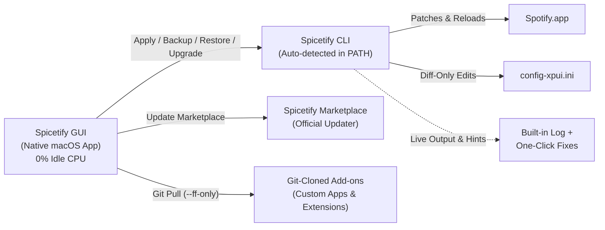

<p align="center">
  
</p>

<h1 align="center">Spicetify GUI (macOS)</h1>

<p align="center">
  A lightweight, native macOS graphical interface for <a href="https://spicetify.app/">Spicetify CLI</a> — zero terminal commands, zero Electron overhead, and 0% idle battery drain.
</p>

## How It Works

Spicetify GUI is a thin native SwiftUI wrapper around your existing Spicetify installation. It reads your setup on demand, runs the exact CLI/Git commands when you click a button, and quits completely when you close the window.



## What You Can Do

| Tab | What It Handles |
| :--- | :--- |
| **Quick Actions** | One-click **Apply**, **Backup & Apply**, **Restore, Backup & Apply**, **Upgrade CLI & Built-ins**, **Update Marketplace**, **Restart Spotify**, **Restore Stock Spotify**, plus a **Run Any Spicetify Command** bar for future CLI flags. |
| **Appearance** | Pick installed themes and auto-parsed `color.ini` color schemes, toggle CSS/JS/color flags, and write only changed keys via `spicetify config`. |
| **Extensions** | Search and toggle built-in or local `.js` extensions, see source badges (`Built-in`, `Git Repo`, `Local`), and update applicable extensions in one click. |
| **Custom Apps** | Toggle and update sidebar apps (`Marketplace`, `Git Repo`, and `Built-in` apps like `lyrics-plus` and `new-releases`). |

## Why It's Lightweight & Update-Safe
* **Minimal power usage:** Compiled native macOS binary (~650 KB) with no Electron, browser engine, or background daemon. Quits completely on window close.
* **Resilient to Spicetify updates:** Dynamically locates `spicetify` (`SPICETIFY_INSTALL`, `~/.spicetify`, Homebrew Apple Silicon/Intel, and `PATH`), ignores unknown future config keys, and delegates edits to `spicetify config`.
* **Actionable error recovery:** Surfaces plain-English banners with one-click fixes when macOS blocks permissions (**Open App Management Settings**) or when a backup already exists (**Restore, Backup & Apply**).

## Requirements
* macOS 14.0 or later (Apple Silicon or Intel)
* Xcode Command Line Tools (`xcode-select --install`) to build from source
* [Spicetify CLI](https://spicetify.app/docs/getting-started) installed

## Build & Install
```bash
chmod +x scripts/build.sh
./scripts/build.sh
cp -R build/SpicetifyGUI.app /Applications/
```

If macOS prompts on first launch (because the app is ad-hoc signed locally), right-click **SpicetifyGUI.app** in `/Applications` and click **Open**.

### First-Time macOS Permission (App Management)
Because Spicetify patches `/Applications/Spotify.app`, macOS requires **App Management** permission for **Spicetify GUI**:
1. Open **System Settings → Privacy & Security → App Management** (or click the in-app **Open App Management Settings** button if a permission banner appears).
2. Enable **Spicetify GUI** (click **+** to add it from `/Applications` if not listed).
3. Quit and reopen **Spicetify GUI**.

### Refreshing the Finder Icon After Upgrading
If Finder still shows a cached icon after replacing an earlier build in `/Applications`, run:
```bash
touch /Applications/SpicetifyGUI.app && killall Finder
```

## License
MIT License — see [`LICENSE`](LICENSE).
